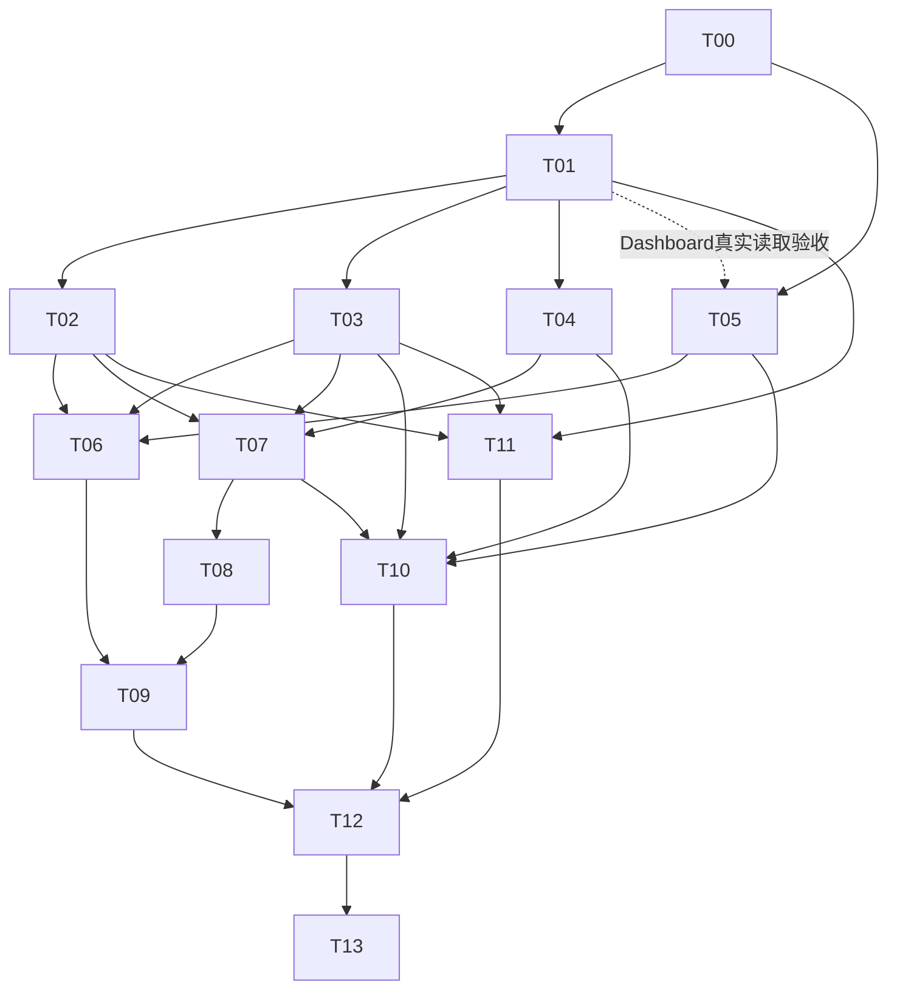

# SeekJournal — Stage 4 Development Task Plan

> 2026-10-30。阶段开发计划，不是本轮执行脚本。
>
> **Goal**：完成桌面 Web UI、统一 Tiptap、开始今天/结束今天、目标同步、可立即导航的保存与 AI，并安全退出 Inbox。
>
> **Architecture**：保留 Journal/Insight，JSON 正文及服务端双投影；应用级会话/写队列；有版本的 Ritual/关联事务；AI prepare/execute/apply 与独立 usage；最后收缩迁移。
>
> **Tech Stack**：既有 React/TS/Vite、CSS/local State+fetch、FastAPI/Pydantic/SQLAlchemy/psycopg/PostgreSQL/Alembic、pytest；Tiptap 免费核心/扩展安装需执行权限。
>
> 本轮只授权 T00 文档编制；T01～T13 均未由本计划获得开始授权。实际已有分支名/产品修改不能据此认领为 Task 完成。状态见 §17。实施可按共同执行流程推进，但不得自动启动 Agent、创建 worktree、安装依赖、执行迁移或 Git 写操作。

## 1. 全局约束与完成定义

产品、API、架构分别引用 `stage4.md`、`stage4-api.md`、`stage4-architecture.md`，不在角色提示词另建版本。Set The Day/End The Day 在前端固定为“开始今天 / 结束今天”。用户八项决定已收口，不重复询问。参数唯一值见 API §8，触发/恢复/生命周期以产品为准。

所有 Task 保留：当前真实 HEAD+diff 基线；先有意义失败/边界用例→最小实现→聚焦自测→停止写入冻结交接→未参与实现的新对话独立测试→列明风险复核→按权限整合→用户接受。任务成功不能以历史数量、开发者报告、分支名或README示例代替实际代码/证据。

本轮已有四个前端修改与一个新增 CSS 必须保留，具体见架构 §1；未来接手这些文件先确认归属、冻结内容及独立验证，不自动覆盖。Doc编制不把当前未提交 UI/保存改动验收成 T02/T05/T06。

阶段二的五文件由阶段二原开发者交付，独立报告记录其停写与当时散列；当前 Codex 原开发会话显示 idle，不能证明其他客户端无写入，T05/T02/T06 接手前重新获取明确交接并复核全部散列。四份 `docs/stage4*.md` 为未跟踪文件，上一写入轮已结束；本轮修订停止后需冻结四份内容及 SHA256 给新独立复核者。`codex/s04-t02` 只是现有分支名，不能据此宣称 Stage 4 T02 完成。

受控保存建议：先冻结 HEAD、status、已暂存和未暂存 diff；另逐个复制五文件和四份未跟踪文档到经授权的私有交接目录，记录相对路径、完整 SHA256、文件大小、来源及身份，恢复演练在独立副本逐项比对，避免覆盖现有工作；不含个人数据库/配置/密钥。`git diff` 不包含未跟踪文件，也不单独构成完整备份。提交是可选方式，需单独授权；此处仅为建议，本轮不创建工作树或备份。

T01 若从提交 HEAD 创建隔离工作区，不会自动带入未提交四份契约或阶段二五文件。实施前获授权由单写者把冻结的四文档作为只读输入交接，按 manifest 验证散列并固定契约版本；阶段二五文件另行受控保存，T01 不覆盖、不自动合入其工作区。T05/T02/T06 接手须明确其五文件可消费基线及独立测试结果；Git整合路径另获授权。任何版本不一致先停止接线、协调，禁止 reset/checkout/merge 或整目录覆盖。

数据库写入仅使用分配且证实实际目标的测试库，独占窗口、manifest清理、未知对象拒绝、序列不重置。个人库默认只读，真实升级单独授权且先备份/恢复验证。公共 docs/agents/AGENTS、迁移链、公共类型及入口由 Codex 协调；同目录单写者，不为三路强拆任务或引入调度器。

## 2. 总表：依赖、角色与风险

模型和执行端唯一引用 `agents/multi-agent-workflow.md` §1；历史模型配置不是当前会话实测。下表 WB=WorkBuddy，本轮仅使用 Codex 和 WorkBuddy；Codex 最多 2、WorkBuddy 最多 3、所有活动 Agent 合计最多 3，开发、测试、审核均计数，阶段二若活动也占名额。所有独立测试使用未参与对应实现的新对话；WB / WB 表示不同会话，不表示同一开发者自测。Codex 实施的高风险项仍需未参与实现的新 Codex 对话风险复核，不以开发自审替代；这不是本轮调用授权。

| Task | 独立交付 | 开发 / 独立测试 | 硬依赖 | Codex 风险门禁 |
|---|---|---|---|---|
| S04-T00 | 四份权威文档、阶段入口、协作资源与状态 | Codex / 后续未参与修订的 WB 文档复核 | 本次已确认决定与文档授权 | 自检契约/依赖/覆盖；未执行修订后的独立文档复核 |
| S04-T01 | JSON/模型/迁移/投影/兼容/基础CAS | Codex / WB | T00可执行契约 | 原文作者/C/引用映射、线性迁移、旧客户端保护 |
| S04-T02 | 应用级编辑与AI请求会话 | Codex / WB | T01 | 真实POST丢响应→PATCH等值、文件隔离、窄effects/CAS |
| S04-T03 | 统一Tiptap编辑/阅读基础 | WB / WB | T01 | 作者与ID保护、兼容节点/粘贴、投影；定向审核 |
| S04-T04 | Ritual后端、模板、唯一与两种恢复 | Codex / WB | T01 | 同日竞争、替换/复制原子、日期/类型不可改 |
| S04-T05 | App外壳、Dashboard、主题 | WB / WB | T00；最终接入T01读接口 | 无额外算法审核；键盘/入口由独立测试验证 |
| S04-T06 | Writing/今日列表/持续编辑 | WB / WB | T02、T03、T05 | 草稿/日期/切页组合定向审核；不重跑保存算法全部测试 |
| S04-T07 | Checklist、关联、双向同步与生命周期 | Codex / WB | T02、T03、T04 | 回答不变、删除解除关联/恢复不自动重连、跨文件CAS |
| S04-T08 | 快照/占位/评论/自动去重AI后端 | Codex / WB | T01、T02、T03、T07 | C/锚点/付费幂等/usage/并发/删除/复盘事务 |
| S04-T09 | AI写作UI、自动触发、全局恢复 | WB / WB | T06、T08 | 原位不丢字、真实输入/系统零循环及unknown；定向审核 |
| S04-T10 | Ritual模板、历史编辑与对照恢复UI | WB / WB | T03、T04、T05、T07 | 复制/替换与目标来源的交叉行为；定向审核 |
| S04-T11 | Insight、Folder/Search/Link/Trash适配 | WB / WB | T01、T02、T03 | 统一入口、编号/引用及JSON权限组合；算法基础由前置保证 |
| S04-T12 | Inbox退出与收缩迁移 | Codex / WB，WB交叉关键场景 | T01～T11独立通过并获约定整合 | 破坏性迁移、混合源隐私、成果/账本保护、恢复演练 |
| S04-T13 | 阶段独立组合验收与最终交付 | WB主测 / WB交叉；新Codex风险复核 | T01～T12、专项门禁和授权整合 | 全部风险关闭，不重复常规Task全量自测 |

## 3. 逐 Task 开发规格

以下路径相对仓库根 `C:\Programme\demo\SeekJournal`。标“新增”是计划路径，不表示已经存在；migration 文件名后缀固定，revision由实施工具生成并登记。每个 Task 的测试输出是实际命令/退出码/HTTP及SQL摘要/必要截图，不以步骤勾选代替成功证据。

### 3.1 S04-T00 — 规划与权威入口

- 文件：新增 `docs/stage4.md`、`stage4-api.md`、`stage4-architecture.md`、`stage4-tasks.md`；同步根 `AGENTS.md`、`agents/multi-agent-workflow.md`、Stage3路线/任务/接受记录的当前状态说明，历史证据保留。
- 输出：八项已确认决定、UI命名、受控节点/接口、数据迁移方案、Task/依赖/Wave/文件所有权/资源/独立测试/回滚，另纳入 C01/C02 结题范围。
- 验证：Markdown链接和章节、Task/验收覆盖、无循环依赖、同Wave无共享写入、仅授权文档变更、产品散列不变。
- 完成界限：文档编制完成不等于独立评审/阶段验收；用户审阅后功能Task仍逐项授权。无Git写入。回滚只修订本轮文档，不回退用户产品改动。

### 3.2 S04-T01 — 正文与数据基础

- 文件：`backend/app/{journal,insight}/{models,schemas,service,router}.py`；`backend/app/journal/titles.py`；`backend/app/writing/{schemas,service}.py`，新增 `backend/app/writing/documents.py`；`backend/app/ai/models.py`、新增 `backend/app/ritual/{__init__,models,schemas,router,dates,queries}.py` 的模型/只读基础；`backend/app/main.py` 注册这些读接口；`backend/app/trash/{schemas,service}.py` 的JSON读形状；`backend/alembic/env.py`、新增 `backend/alembic/versions/*_stage4_document_foundation.py`；`backend/scripts/prepare_test_db.py`、`backend/tests/conftest.py`；公共前端 `types/{file,journal,insight,writing}.ts`、`api/{journals,insights}.ts`，新增 `api/rituals.ts`、`types/ritual.ts` 的读取契约。
- 输入：产品 §2/5/8，API §1～4/10，架构 §3/8/10。输出：schema1、`validate_document`、`project_document`、`user_text_document`、受控节点操作及合成golden fixtures；content_doc/journal_kind/模板/links/comments/AI字段的M4A基础；Journal列表kind筛选与只读business-day/rituals数据接口。T04实现Ritual业务写流程，T08实现AI执行，不能在此提前扩成全阶段开发。
- 步骤：先写旧数据/作者/C/引用/双会话失败测试；完成线性扩展和可证明转换/兼容节点；接入CRUD与旧客户端防扁平化；同步Model注册/守卫；局部测试、冻结交接。
- 验收：旧ID/date/Folder/创建键/hash/时间/序列保留；全部旧Journal归writing；纯读零写；原文兼容不混AI；C映射有证据/不能证明保留原C；无重复AI；同版本并发仅一方成功；无变化不改时间；Ritual不占普通日记编号。
- 测试：新增 `backend/tests/test_s4_documents.py`、`test_s4_migrations.py`、`test_s4_journal_kinds.py`；回归 `test_writing_blocks.py` 的原意、`test_file_revisions.py`、`test_file_create_idempotency.py`、旧迁移/GET零写/长度/If-Match边界。验证TS/Python黄金样例的码点、换行和作者一致。
- 消费契约：API §2/§2.1 是 schema、NULL 详情形状和作者权限的唯一来源，架构 §3 是 R/U/C 投影；T01 创建并冻结根目录 `tests/fixtures/stage4_documents/{valid,invalid,projections,legacy}.json`，Python 与 T03 的 TypeScript 从同一路径消费并对照相同样例，冻结文件及 hash 后交接。NULL GET 保留旧文和 blocks、零写；旧客户端不得扁平化已转换文件；创建键/CAS与不可安全转换保留旧文按 API §1～3、架构 §10。
- 回滚：M4A只在合成库演练downgrade；新格式已写则按架构 §10.3，不盲降。未知结构事务回滚并保留原文。独立WB及新Codex重点审核转换/写权限。

### 3.3 S04-T02 — 应用级保存与请求会话

- 文件：新增 `frontend/src/state/{editSessions.ts,editSessions.test.ts,aiRequests.ts,aiRequests.test.ts,localJournalDrafts.ts,localJournalDrafts.test.ts}`、`frontend/src/hooks/useEditSession.ts`；修改 `hooks/useAutosave.ts`、`utils/{autosave,autosave.test,aiRequestState,aiRequestState.test}.ts`、`App.tsx`；公共接口变更由Codex串行同步。当前已有hook/App改动先交接，不覆盖。
- 输出：`openSession`、`changeSession`（origin明确）、`captureSession`、`saveToSequence`、`runFileCommand`、`applyFileMutation` 和订阅hook；应用级AI请求Promise/恢复，供T03/T06/T09/T10/T11消费。不让每页再建立独立写队列。
- 验收：每文件单在途，创建身份切换不重建草稿；POST响应丢失后保留原payload/键，取得ID后实际PATCH最新输入；导航立即执行，未挂载文件保存/失败可恢复；跨文件与旧seq响应隔离；有限序号屏障不阻用户持续输入；关联队列按typed key顺序，未知差异CAS保留；beforeunload不承诺强关保存。
- 测试：上述纯逻辑测试及现有autosave/AI恢复测试；延迟/乱序/500/409/POST提交后断响应的真实浏览器→HTTP→PG。三种Journal用途和Insight至少覆盖创建/续写/返回；真实PATCH与最终UI/DB不等即失败；中文IME切页需要实际设备行为。
- 回滚：停止新增调度并保留会话/首次请求快照，先处理在途/冲突再版本切换；不得以刷新解决输入。WB新对话独测，新Codex复核防丢字与effects权限。
- 本地恢复新增验收：IndexedDB 按标签/草稿隔离最新未提交 Journal；本地写入成功和服务器已保存分开显示。重开列出候选并明确恢复/稍后/丢弃；GET 比较 revision，冲突保双方，404/软删/网络失败不丢草稿；新建响应未知以原键原首次 payload 重放，后续输入以 CAS 写入。确认序号前的旧响应不能清除更新草稿或其他标签。存储不可用/满/损坏/版本不兼容告警并保内存及可读记录；用户可清除本应用草稿，不清其他站点数据。详见产品 §10、API §10、架构 §4.1。
- 本地恢复测试：真实浏览器关闭重开、强制进程终止、模拟断电导致的未完成写入（只证明最后成功持久化内容）、两标签不同草稿与跨标签 CAS、延迟乱序/创建响应丢失、网络失败/服务器删除、真实中文 IME composition 和组合结束、IndexedDB 配额/权限/事务失败及清理后重开。测试与证据使用合成文本；意外断电无法保证最后一次输入恢复，不把模拟当真实断电保证。

### 3.4 S04-T03 — Tiptap 基础编辑器

- 文件：新增 `frontend/src/editor/{schema.ts,RichTextEditor.tsx,RichTextEditor.css,documentProjection.ts,documentProjection.test.ts}`、`editor/extensions/{AiReply.ts,AiSummary.ts,AiPlaceholder.ts,RitualQuestion.ts,GoalItem.ts,GoalReview.ts,MindComment.ts,LegacyText.ts}`；修改 `components/{WritingEditor,WritingContent,AiReplyBlock}.tsx`、`package.json`、`package-lock.json`（安装授权后）。
- 输出：`RichTextEditor` 以doc/readOnly/onUserChange/onSelection为接口；文档扩展与稳定ID、普通Checklist、受保护容器和基础Mark。只做目标/评论节点呈现与合法编辑边界，跨文件/AI写逻辑分别归T07/T08。
- 验收：普通Journal/开始今天/结束今天/Insight同一基础；格式/列表/代码/安全链接、AI总结可改仍保身份；AI回复不能伪造/改来源；复制/分裂/撤销重做无重复ID；旧文兼容节点可读可恢复；只读模式不自动加ID落库；Mark和格式不改U。
- 测试：documentProjection与共享golden fixtures、build/lint、实际浏览器中文IME/粘贴/撤销/回车/Checkbox/只读/旧超长/恶意HTML协议/重复节点；不安装新测试框架代替浏览器证据。
- 回滚：编辑器必须遵守schema版本与旧客户端409保护，不把新文转回一串content丢来源。WB独测；Codex定向审核作者/原文。完成后目标扩展交T07、App入口交Codex，停止交叉写入。

### 3.5 S04-T04 — Ritual 后端与恢复

- 文件：新增 `backend/app/ritual/service.py`，扩展T01建立的 `backend/app/ritual/{schemas,router,dates,queries}.py`、`frontend/src/api/rituals.ts`、`frontend/src/types/ritual.ts` 的写入/恢复契约；修改 `backend/app/journal/{service,schemas,router}.py`、`backend/app/trash/{service,schemas,router}.py`、`backend/app/main.py`；Model/迁移若需修正仍由Codex单写。
- 输出：模板CAS、固定时区/捕获日期验证、每日唯一、软删/普通恢复、完整替换与手动选区复制。goal生命周期hook在T07接完整实现，T04先证明不含关联的事务、ID和作者安全。
- 联动交接：T04 在无 link 的隔离基线先交付恢复事务，并对发现任何受影响 link 的操作明确拒绝/回滚（例如 409 `related_files_changed`），不得跳过解除或半写；T07 按 API §5–6 接手同一生命周期入口，在同事务核对版本、解除所有受影响关联、保留 End 快照和回答，补并发/故障独立验收。含关联的 restore-replace 不得在 T07 集成前宣称符合完整契约；T04/T07 相关服务单写串行。
- 2026-10-30 用户批准复制选区改为 paragraph/heading ID 加 Unicode 码点范围，并新增服务端持久幂等记录；契约见 API §5、架构 §5。Codex 独占 Model/线性迁移与公共契约，测试库迁移仍先核对实际库、独占及基线；个人库升级另行授权。
- 验收：0～4问、缺行GET零写；类型/日期不让通用PATCH绕过；两Session竞争名额一胜一409；跨04:00仍原草稿日期；开始今天和结束今天均有完整替换及copy-content；源/目标类型日期不匹配拒绝；复制AI由真实源构造，普通取消零写，响应丢失/重放不双复制；任一故障无双有效/半替换。
- 测试：新增 `backend/tests/test_s4_ritual_api.py`、`test_s4_ritual_recovery.py`、`test_s4_templates.py`；03:59:59/04:00、月年闰日、浏览器不同时区；软删/重建/旧恢复冲突、源和目标各自CAS、恶意来源/范围、SQL故障；保留普通Trash与If-Match回归。
- 回滚：替换只软删current，不永删；事务失败全回滚；copy保留原source。CAS失败不清本地草稿。WB独测，新Codex复核名额/复制/事务。

### 3.6 S04-T05 — 外壳、Dashboard 与主题

- 文件：`frontend/src/{App.tsx,App.css,index.css}`；新增 `components/{AppShell.tsx,AppShell.css}`、`pages/{DashboardPage.tsx,DashboardPage.css}`、`utils/{theme.ts,theme.test.ts}`。不改T01公共数据类型/后端写业务。
- 输入：已确认UI边界；先开发可使用的外壳/主题，Dashboard最终读取T01接口后才可验收。输出布局插槽/导航回调，后续App根接线由Codex维护。
- 最小布局插槽：`AppShell` 接收 `navigation: ReactNode`、`context: ReactNode | null`、`children: ReactNode`、`aside: ReactNode | null`；仅负责布局与响应式，导航通过现有 `App.tsx` 的回调与保存会话协调，不自行读写业务数据。桌面可并排上下文和正文，窄屏上下文可折叠且键盘可达；T05 冻结组件接口与样式后交 Codex 接线，T06 提供今日列表节点、T09 提供评论侧栏节点，不并行修改 App。UI 具体视觉由用户验收。
- Dashboard真实读取门禁：T01 的实际后端与接口、M4A 在分配的隔离库通过验证且可消费后，由 Codex 持有迁移/后端与测试库独占窗口并交付版本、端口、目标证明；T05 WorkBuddy 在后端写入者停用该库后独占 UI/HTTP 测试。先检查数据库服务、目标 `current_database()`、实际进程目标、Alembic current/head 与 M4A 一致、端口/其他会话/manifest，确认合成数据与可清理范围；不能假设 `seekjournal_test_02` 已存在、可用或已升级。未满足门禁只验外壳/Mock，Dashboard真实读取未验证。
- 验收：概览/写作/日记/Insight/Folder/Search/Trash/Settings入口齐；开始今天/结束今天无缩写漏出；浅/深/系统主题可持久恢复；Dashboard读取零创建、空/错/加载状态清楚，桌面及基础窄屏、键盘可用。无RAG/情绪统计/语音/今日汇总文件。
- 测试：theme纯逻辑、build/lint、桌面和窄屏截图/焦点顺序/对比度代表检查、真实读接口，确认进入概览不会POST。不把静态mock截图当真实数据接线通过。
- 回滚：仅外壳可独立退回，数据不变；WB完成后停止App共享文件写入交Codex。WB独测，无额外算法门禁。

### 3.7 S04-T06 — Writing 与今日总览接入

- 文件：新增 `frontend/src/pages/{WritingPage.tsx,WritingPage.css}`、`utils/{writingSession.ts,writingSession.test.ts}`；修改 `components/{JournalEditor.tsx,JournalDetail.tsx,JournalList.tsx,JournalPage.css}`、`api/journals.ts` 的页面消费（公共接口改动交Codex）；Dashboard子组件/回调，App只交Codex串行接线。
- 验收：首次进入空writing草稿、返回同会话、明确新建才换键；当日侧栏只列writing/预览、点文件继续；动态总览含两Ritual且不存汇总；已保存跨日按捕获日期保留、未保存输入不丢；失败切页后有返回入口，列表刷新失败不再POST；历史普通Journal仍可改日期。
- T06 消费 T02 本地草稿接口，在 Writing/日记入口呈现可发现候选、恢复/稍后/明确丢弃和冲突两方入口；不复制第二套存储或绕过 T02 的版本比较。验收重开后可操作、空/错误/无障碍提示，关联 S4-A19。
- 测试：writingSession/日期/分页/旧标题测试，build/lint；真实20+1文件分页、打开空页零写、两草稿创建键、切页续写、04:00/时区、长标题无截断、POST/PATCH与UI/DB等值。T02算法已独立通过后只补UI实际路径，不重复全量核心测试。
- 回滚：UI不清会话、不删已存文件；必要时回退页面保留编辑恢复入口。WB独测，Codex定向审日期/保存接线。

### 3.8 S04-T07 — 目标同步与生命周期

- 文件：新增 `backend/app/ritual/goals.py`、`frontend/src/components/{GoalReview.tsx,GoalReview.css,GoalActions.tsx}`、`frontend/src/api/ritualGoals.ts`、`frontend/src/utils/{goalState.ts,goalState.test.ts}`；修改T03已交接 `editor/extensions/{GoalItem,GoalReview}.ts`、T04的ritual/journal/trash业务入口；link Model在T01创建，不平行开迁移链。
- 输出：Set canonical目标、主动加入End、双向文字/完成状态、系统标题、独立answer、可见性状态与固定锁顺序；返回多文件FileMutation，不在组件各自PATCH两端。
- 验收：未关联零End写、重复加入唯一；新End带目标内容原子创建且日期合法；从两端改动最终一致；回答子树逐字段不变；完成仅展示置底；删除goal或任一Ritual解除关联，End保留快照和回答；恢复不自动重连，主动重关联不覆盖回答；丢响应/超限/409/SQL故障不半写。
- 测试：新增 `backend/tests/test_s4_goal_sync.py`、`test_s4_goal_lifecycle.py`；真实双Session并发/固定锁顺序/关联集合改变、End未保存回答与同步相遇、完整替换及手动复制goal新ID、不隐式跨日创建；goalState与浏览器实际文字/勾选/排序/回答摘要。不得只看UI相似就称两端持久化同步。
- 回滚：事务失败整体回滚；按用户确认的删除语义解除关联但保留 End 快照/答案；软删文件可同ID恢复，恢复不自动重连。WB独测、新Codex专项复核跨文件一致性。

### 3.9 S04-T08 — AI 快照、原位与评论后端

- 文件：`backend/app/ai/{local,requests,incremental,schemas,router,prompts,settings,review,review_save,usage}.py`；新增 `backend/app/ai/{writing_requests,comments}.py`；`backend/app/writing/documents.py` 的受控应用及 `writing/service.py` 删除；`frontend/src/api/ai.ts`、`types/ai.ts` 公共契约；必要Model修正由Codex单写。
- 输出：API §7的prepare/execute/apply、Minds范围/预置/评论CRUD、auto去重、原请求安全恢复、JSON复盘/一次保存适配；复用现有官方客户端和受限工具，不改供应商/权限或增加worker。
- 验收：prepare保存快照/占位，execute同ID只一次，上游期间无DB锁；用户下方续写仍能原位apply，C仅到调用快照；旧范围/删占位/软删/恢复/unknown迟到不附着；Minds重复quote不误挂，失锚侧栏保结果、不给GoDeeper推进C；usage子调用/unknown/匿名累计不二计；自动双标签同hash一请求；复盘7日期15file/源变/一次确认/Insight草稿链路不退化。
- 测试：新增 `backend/tests/test_s4_ai_writing.py`、`test_s4_ai_comments.py`、`test_s4_ai_auto_dedupe.py`；保留现有incremental/local/recovery/review-save/evidence/usage/tool/privacy/deletion边界并按新契约更新；真实PG两Session、结果ready后存储故障、超限、模型/搜索超时、丢HTTP、重启、恶意quote/ID。Model用Mock先证明边界；真实付费链另行授权。
- 回滚：停自动触发/新execute，既有ID查询恢复；保留已消耗usage和ready结果，不清记录再发。WB独测，新Codex审C/幂等/计量/事务。

### 3.10 S04-T09 — AI UI、自动调度和跨页恢复

- 文件：`frontend/src/components/{AiWritingActions.tsx,AiReplyBlock.tsx,ReviewPreview.tsx}`；新增 `components/{MindsSidebar.tsx,MindsSidebar.css,GlobalRequestStatus.tsx}`、`state/{autoAi.ts,autoAi.test.ts}`；`pages/{ReviewPage.tsx,SettingsPage.tsx}`、`utils/aiRequestState.ts` 的接线需Codex先交接。App/会话核心变更仍Codex串行。
- 输出：手动/快捷键与两个持久自动开关、静态预置选择、行内占位、Mark/侧栏、全局请求入口；Review选源/预览/保存状态使用应用会话。
- 验收：GoDeeper手动/自动都原位且下方可写；所有AI期间立即导航、迟到不跳回源页；15s/80码点/60s初始参数边界可验证；启用/打开旧文不冒充输入；IME结束后算码点；系统模板/同步/AI/复制0付费循环；两开关独立、同源串行；unknown/404只查与说明，不自动换键；评论失锚不误挂；完整复盘确认一次及Insight另加一份保持。
- 测试：autoAi纯逻辑用确定时钟/调用计数验证79/80、14.999/15、59.999/60、emoji/中文和visibility；真实浏览器→HTTP→PG延迟调用中续写/切页/返回/重启查询、删除占位、旧范围改动/Mark消失、重复多标签、评论删除/计量、Review预览跨页编辑保留。真实供应商费用测试分列。
- 回滚：关闭开关停止未执行调度，保留在途/unknown索引，不以重载/清索引触发新请求。WB独测，Codex定向审系统事件与保存effects。

### 3.11 S04-T10 — 两种 Ritual UI 与手动恢复

- 文件：新增 `frontend/src/pages/{RitualPage.tsx,RitualPage.css}`、`components/{RitualQuestions.tsx,RitualRestoreCompare.tsx,RitualRestoreCompare.css}`、`utils/{ritualView.ts,ritualView.test.ts}`；消费T04 ritual API与T07目标组件，不改其服务/Model/编辑扩展。App路由提交Codex接入。
- 验收：全前端“开始今天 / 结束今天”；左右上下文只当前模板/最多四问；点击插入、改模板不回写、历史有效正文可改；两种Ritual都能完整替换、手动选择复制/取消；无自动合并；删除解除关联且快照/答案保留，恢复不自动重连；CAS/重读失败保本地草稿；跨04:00保持输入和捕获日期。
- 测试：ritualView/build/lint；浏览器0/4/5问、模板重开、历史改正文、两种Ritual各三种冲突选择、源/目标并发更新、复制AI作者/目标新ID/取消零写、删除解除关联及恢复不自动重连和End答案SQL摘要、失败跨页返回。
- 回滚：取消对照零写，恢复失败不清草稿；UI回退不解除关联或把历史正文设只读。WB独测，Codex定向复核跨文件恢复接线。

### 3.12 S04-T11 — 既有模块兼容

- 文件：`backend/app/{folder,search,link}/{schemas,service}.py`；`frontend/src/pages/{InsightPage.tsx,FolderPage.tsx,SearchPage.tsx,TrashPage.tsx}`、`components/{FileCard.tsx,LinkCandidates.tsx,InsightDrafts.tsx,MarkdownContent.tsx}`；`utils/{homeSearch,insightDraft,insightAiDraft,reviewSelection,internalLinks,markdownReading}.ts` 与测试；对应页面独有CSS/API/types。公共FileType/Journal/API、后台Trash/Ritual服务、AI模块不由WB并行改，接口调整提给Codex。
- 输出：Insight统一编辑接会话，Folder/Search/Link的两类活动文件与JSON投影、Trash前端阅读、正式Review→Insight和另加一份接入新编辑器。Inbox运行时物理移除与最后类型收缩归T12。
- 验收：关键词AND/字面通配符/20全局分页/陈旧读取消、精确标题单多零候选/代码区域不激活/404不新建、Folder有效/回收箱引用保护、Trash只读/保时间/末页回退、Insight创建重放/真实PATCH/另加新键；未知请求不绕过JSON作者验证。
- 测试：现有相关后端/前端测试按Stage4活动集合更新，保留原测试意图并增加Inbox退出断言；真实HTTP/PG及浏览器通过各模块打开同一JSON文件/编辑/导航/软删/恢复/来源不可用。不能用DEV注入面板替代正式接线。
- 回滚：只回退适配差异，保留已存正文和创建键；不得保留content写入口绕过保护。WB独测，Codex审核公共契约交叉影响。T04后台Trash先完成，WB只消费形状，避免同Wave写冲突。

### 3.13 S04-T12 — Inbox 退出与最终收缩

- 文件：删除当前 `backend/app/inbox/`、`frontend/src/pages/InboxPage.tsx`、`api/inboxes.ts`、`types/inbox.ts`、`utils/inboxDraft.ts` 与仅属Inbox的废弃实现；修改 `backend/app/{main.py,ai/models.py,ai/requests.py,writing/service.py}`、`backend/alembic/env.py`、新增 `backend/alembic/versions/*_stage4_retire_inbox_blocks.py`、测试守卫/fixture、公共FileType、App/恢复索引与残留消费者；**不删除/改写历史迁移文件**。
- 验收：无Inbox UI/功能/API/OpenAPI/当前Model/表/type分支；旧路由404、非法type422；混合sources请求整行清理、Inbox C清理、其他C保留、usage匿名累计保持、已存Journal/Insight/总结不动、Folder不级联、失效链接合理、旧执行者不复活私人快照；旧blocks字段所有保留内容安全转JSON后才DROP。
- 测试：新增 `backend/tests/test_s4_retirement.py`；在合成数据上完整M3→M4A→M4B、带Inbox混合review/已有结果/usage/C/Folder/内部引用、旧进程迟到模拟、事务失败/未知依赖拒绝；升级/回退备份恢复比较正文/作者/序列/时间/累计。现有Inbox专属测试被退役契约测试替代，不能只删除失败测试获取绿灯。
- 权限门禁：前置全部独立通过、写入冻结、未知/pending处理完、精确删除台账、备份+恢复验证通过。真实个人库迁移单独授权；没有权限仅交付迁移/合成演练证据，不执行个人库升级。
- 回滚：提交前全事务回滚；DROP后须备份恢复，新增数据另行保护，不能宣称downgrade恢复已删正文。WB独测、WB交叉关键保护，新Codex必须风险复核。

### 3.14 S04-T13 — 独立组合验收与阶段交付

- 文件：产品实现只读；新增 `docs/s4-acceptance.md`，按授权更新本文件§17；证据置 `.workbuddy/s4-t13-independent/` 并脱敏，独立manifest只含本轮自建对象。缺陷退回所属Task，测试者不静默修产品。
- 输入：已整合的实际HEAD+diff、各Task独立证据、六类高风险复核及剩余权限；历史Stage3通过不代替本阶段验证。
- 验收：S4-A01～A19逐项通过/失败/未验证；真实浏览器→HTTP→PG和Windows中文IME；本地草稿断网/重开/崩溃/存储异常/多标签恢复；自动触发真实/Mock明确；各类恢复/关联/并发/原位/计量/Inbox/迁移/引用回归、服务与数据收尾；用户最终接受后才可报告Stage4完成。
- 测试：在资源守卫通过后运行一次必要全量pytest/build/lint、现有与新增纯逻辑；关键UI/HTTP/SQL场景独立跑，只有新修改/失败/疑点才追加复跑。真实AI/搜索用合成文字及另批预算，缺权限标未验证，不用Mock补成真实通过。
- 独立性：WorkBuddy 新对话主测未参与实现的后端或前端路径，另一个未参与对应实现的新对话做交叉验证；Codex 新对话复核高风险项。总报告引用独立证据，不把开发者自测拼成阶段独立验收。测试资源串行预约。
- 回滚/清理：仅清manifest自建对象，不清陌生数据/重置sequence；只停自建服务，保留失败证据与待办。Git、Stage接受、发布权限分别记录，不自动提交/合并/推送。

## 4. 依赖图与接口冻结

### 结题新增任务 C01：独立日程与情绪反馈

- 范围：日程独立于 Set 目标，分别创建、完成、删除，不自动同步；Set/End 主动关联规则不变。日程支持创建、查看、编辑、删除、完成与持久化；自然语言日程建议和情绪推测由用户确认后保存，情绪标为推测、不作诊断，模型失败时手动日程仍可用。
- 建议 Codex 开发、WorkBuddy 新对话独立测试；前置为 T00 契约审阅和单独开始授权。拟建 `backend/app/schedule/{models,schemas,service,router}.py`、`frontend/src/pages/SchedulePage.tsx`、`frontend/src/api/schedules.ts`、`frontend/src/types/schedule.ts`，测试 `backend/tests/test_schedules.py` 及专属前端测试；字段和 CRUD 以 API §13 为准，缺失时间的建议需用户补充或修改。
- 独占线性迁移链和公共类型/入口接线由 Codex 排队：T01 的 M4A 已验证并按授权整合，核对真实唯一 head 后才由 Codex 在该 head 创建 C01 后续迁移；不得由两分支各从旧 head 并行开迁移。验证合成数据 CRUD、完成状态、重启持久化、确认前零写、网络/模型失败以及 Set 修改零影响，真实付费调用单独授权。
- C01 与 Android C02 是结题新增任务，不把它们误记为原 T00–T13 已完成。C02 使用用户已接受的同网络手机＋电脑后端作为候选；版本、依赖、监听/CORS/防火墙、安全方案和设备实测各按权限及实际证据确认。



图为主要边，T12硬依赖仍是T01～T11全部通过。T05可在W1先完成外壳/主题，真实Dashboard读取要等T01；不会以静态壳子作为Task完成。T03独立组件消费T01 schema，不依赖T02未交付源码；W2两项各自验证后再做接入验证。后续Task使用新集成基线，不依赖从另一个worktree直接引用未提交源码。

## 5. 文件所有权与交接

| 共享边界 | 所有权与交接 |
|---|---|
| AGENTS/docs/agents、公共契约/类型、迁移链/Model注册/守卫 | Codex唯一协调写入；其他执行者只提所需差异，不并行开head或改fixture绕过守卫 |
| C01 后端与接线 | Codex 持有 `backend/app/schedule/`、`main.py` 注册、迁移/`alembic/env.py`、`prepare_test_db.py`/conftest 与公共类型；与 T01→C01→T12 按已验证且授权整合的 head 串行；WorkBuddy 只持有经交接的专属前端组件，`App.tsx` 最后由 Codex 接线 |
| App.tsx/App.css/index.css | T05的WB先拥有；冻结交付后T02及后续统一交给Codex；T06/T09/T10/T11交组件/props/路由差异，不自己并行改App |
| journal/writing/trash后端事务 | Codex T01→T04→T07→T08→T12串行；WB T11不改这些服务 |
| editor/extensions | WB T03完成后冻结；目标扩展明确交T07 Codex，T10只消费，不能一边改NodeView一边改恢复 |
| 编辑会话与aiRequestState | Codex T02；T09需要接线时先交接该局部文件，若核心需修由Codex处理；不复制第二套请求管理器 |
| Writing与普通Journal UI | WB T06；当前未提交文件先确认归属；WB T11不改这些组件或其CSS |
| Folder/Search/Link/Insight/Trash前端 | WB T11；独有CSS，不改App全局样式和AI/编辑器核心 |
| RitualPage/对照UI | WB T10；目标组件/API由已交付T07提供，不反向改canonical逻辑 |
| 独立测试 | 实现者停写，测试者新对话核对冻结HEAD+diff，必要脚本独有目录；发现产品缺陷退回原所有者 |

## 6. 并行 Wave 与整合顺序

并发上限及计数以 §2 为唯一来源。以下是当前建议而非启动指令；独立测试须未参与对应实现的新对话，实际执行端及资源获明确授权后再分配。任何写入与该基线独立测试不可同时进行，同一测试库、迁移链、公共类型和入口串行。只有两项独立工作就两路，不要求第三路持续开发。

| Wave | 可同时活动的槽位（每项均占一个） | 前置和串行条件 |
|---|---|---|
| W0 | Codex T00修订；WorkBuddy 独立复核 | 写入者停止并冻结；测试不能与修订同时作用同一基线 |
| W1 | Codex T01；WorkBuddy T05 独立外壳；WorkBuddy C01 只读设计 | 契约复核及各 Task 授权；阶段二先交接；C01不改迁移/公共入口；T05真实数据验收等待 T01 |
| W2 | Codex T02；WorkBuddy T03；WorkBuddy 独测已冻结 T01 或 C01 独立组件 | 契约与依赖冻结；共享文件、同一测试库排队；T01独测期间停止修改 |
| W3 | Codex T04；WorkBuddy T06；另一 WorkBuddy T11 | 前置已交付；共享入口/事务/测试库串行 |
| W4 | Codex T07；WorkBuddy 测试已冻结任务；另一 WorkBuddy C01 | C01迁移须 T01已验证并按授权整合、最新单一head核验；测试和修复串行 |
| W5–W6 | Codex T08或风险审核；WorkBuddy T10或T09；另一 WorkBuddy 独立测试已冻结任务 | 实际依赖就绪；开发者与独测者为不同对话；接线及测试库串行 |
| W7 | Codex T12；冻结后 WorkBuddy 独立测试及另一个 Codex 风险复核 | 依赖、授权、备份与恢复门禁通过；同一基线先写后测 |
| W8 | WorkBuddy T13 与另一未参与对应实现的 Codex/WorkBuddy 交叉复核 | 版本冻结；测试时不修改产品；真实/Mock与用户接受分列 |
| W9 | Codex C02；完成后 WorkBuddy 独立复测 | Web稳定、工具/设备/具体权限就绪；APK及设备结果未实施前标未验证 |

每波出口必须纳入未提交 diff 与未跟踪文件，缺整合权限则交付完整待测材料，不把 worktree 复制或提交标题当集成。

## 7. Worktree、端口、数据库资源

| 路线 | 拟定目录/分支 | 端口 | 环境与库 |
|---|---|---|---|
| Codex开发 | `C:\Programme\demo\SeekJournal-Codex-S04`，开始前检查复用条件；候选分支依次为 `codex/s04-t01-doc-foundation`、`codex/s04-t02-app-state`、`codex/s04-t04-ritual`、`codex/s04-t07-goals`、`codex/s04-t08-ai`、`codex/s04-t12-retirement` | 前端5184 / 后端8034 | 独立进程环境，VITE_API_BASE_URL指8034，DATABASE_URL明确测试库；优先seekjournal_test |
| WB开发 | 可复用 `C:\Programme\demo\SeekJournal-Work-01`；所有者确认停写/干净/同步；候选分支 `codex/s04-t05-shell-wb`、`codex/s04-t03-editor-wb`、`codex/s04-t06-writing-wb`、`codex/s04-t09-ai-ui-wb` | 5185 / 8035 | 独立API地址/环境；优先seekjournal_test_02预约窗口 |
| WB第二独立会话 | 可复用 `C:\Programme\demo\SeekJournal-Work-02`；同样先确认/同步；分支另行按授权确定 | 5186 / 8036 | 两个白名单库预约独占；未获库时仅无DB的开发/Mock，不起写库后端 |
| C01 Codex 开发／WB独测 | 由获授权的独立工作区与待测基线确定 | 候选前端 5187／后端 8037，使用前核查 | 在 `seekjournal_test` 或 `seekjournal_test_02` 中预约独占；开发者停用后独测接手；核对实际目标库、Alembic head/current、表/连接及 manifest，任何库均不预设就绪；迁移前 T01 M4A 集成门禁 |
| 文档/整合入口 | 当前 `C:\Programme\demo\SeekJournal`，现有产品修改先保留/交接；不据此自动切回main | 不占开发服务 | 只按用户Git权限整合；本轮不启动实例或改.env |

路径/端口是规划候选，未创建、未预占，开始前查实际占用；不能强制结束他人实例。Work-01/02仍在旧HEAD，不自动认为已同步或无人使用。优先复用合适的已授权隔离worktree；新建需要具体授权，不为形式创建。

当前只有两个白名单测试库。W3三路时，Codex在test窗口，WorkBuddy 对话在 test_02 排定先后；第三路此时只做不写DB的组件/Mock工作，真实HTTP/浏览器写入移到独占时段。不同端口不等于不同数据库，pytest、迁移、HTTP、UI、独立测试都计入该库占用。测试者接手前开发后端停止使用该库，不在测试期间热重载开发修改。

资源日志至少记录实际current_database/revision/表基线/其他连接/私有schema/所有者、端口与自建PID、DATABASE_URL目标库确认（不输出连接串）、manifest。固定共享迁移/完整pytest串行。最多三路不授权建第三库/改白名单/安装依赖。原5173/8000/5432默认保持，不修改真实.env/Compose。

## 8. 测试命令与证据约定

以下只供获授权实施/独立测试时使用，本轮未执行。运行前必须完成§7守卫；并非照抄命令就获得数据库权限。

后端工作目录 `C:\Programme\demo\SeekJournal-Codex-S04\backend`（或对应获授权worktree）：先设置获分配的SEEKJOURNAL_TEST_DB；pytest fixture会切换DATABASE_URL，但HTTP/Alembic必须另在实际进程设置/核实，不能拿fixture配置替代真实服务目标。

```powershell
$env:SEEKJOURNAL_TEST_DB = 'seekjournal_test'
.\.venv\Scripts\python.exe -B -m pytest -q -p no:cacheprovider tests/test_s4_documents.py tests/test_s4_migrations.py
```

上例T01测试文件由该Task创建；其他Task运行其§3具体聚焦文件与受影响现有回归。完整后端在最后必要窗口运行 ` .\.venv\Scripts\python.exe -B -m pytest -q -p no:cacheprovider tests`。M4A/M4B heads/current/check和升级/恢复演练由Codex记录实际命令/目标，不先运行可能写入/迁移的prepare脚本当检查。

前端在对应worktree的frontend下运行 `npm run build`、`npm run lint`；纯逻辑命令例如T02的 `node --experimental-strip-types src/state/editSessions.test.ts`、T03的 `node --experimental-strip-types src/editor/documentProjection.test.ts`、T09的 `node --experimental-strip-types src/state/autoAi.test.ts`，其余按§3列明文件运行并记录实际路径。Tiptap/IME/导航/Mark用浏览器验证，不用纯函数断言冒充实际交互。

证据最小集合：实际HEAD+diff散列、命令/退出码、HTTP请求顺序与状态、SQL正文/身份/版本/答案摘要、关键截图、Mock/真实分类、失败分类、manifest及清理摘要。正文/Key/真实提示词不进入Git或公开报告。自测与独立测试分目录，新会话不用“看上一轮对话”替代自包含契约。

## 9. 专项风险门禁

| 风险 | 所属Task | 必须通过的独立证据 |
|---|---|---|
| 旧文/作者/C/引用与迁移 | T01/T03/T12 | 合成旧库升级、原文兼容、投影映射、未分析文字未被消费、失败原文可恢复 |
| 跨页保存/创建丢响应 | T02/T06 | 原键原payload重放后真实PATCH、最终UI/DB等值、跨文件迟到/IME/CAS保输入 |
| 唯一/替换/复制 | T04/T10 | 两Session竞争，两种Ritual均恢复，双方CAS/SQL故障无半写/双有效 |
| 目标/软删恢复 | T07 | answer逐字段不变、删除解除关联、同ID恢复不自动重连、主动重关联不覆盖快照或回答 |
| AI原位/C/评论/自动 | T08/T09 | 下方新增保留、旧范围改动冲突、失锚不误挂、系统0循环、自动多标签去重 |
| 计量/隐私/Inbox | T08/T12 | 官方usage语义/unknown/匿名累计、混合请求整清、其他C与已存成果保持、迟到不复活 |

新Codex复核只审这些风险的实际diff与独立证据、必要定向复跑；不参与实现后自称独立。不额外要求常规样式每项全量复核。

## 10. 回滚清单

- UI/会话改动：先保留/处理在途和较新输入，不能刷新丢草稿。新客户端不能用content旧写法回退已转换文件。
- Ritual/目标/AI应用：一个业务事务失败全回滚，外部消耗/usage不回滚；不得重发付费请求代替应用重试。
- M4A：新结构尚未产生数据时可在合成库退；新文/评论/链接已写后先保当前备份，证明无损才下转，优先向前修。
- M4B：DROP后只能依赖验证备份，真实恢复另获授权并保护之后新增数据；不得宣称自动downgrade找回Inbox。
- Git代码回退/合并/备份恢复不由本计划自动执行，保留实际diff与用户权限记录。

## 11. 开始授权与权限表

| 操作 | 当前权限 |
|---|---|
| 本轮四份开发文档及必要阶段/协作说明 | **已授权** |
| 修改产品代码/测试实现、执行T01～T13 | 本轮不授权；未来明确Task指令后按根/共同协议核对，不重复询问已确认六决定 |
| 调用/创建Agent或跨客户端派发 | 本轮禁止；人数许可不是启动授权 |
| 创建/切换/同步/清理worktree或分支 | 本轮不授权；未来具体Git权限登记 |
| npm安装/升级及Tiptap锁版本 | 本轮不授权；T03执行前核对已批准包清单/安装范围 |
| 测试库写入/迁移/新服务 | 本轮不执行；未来按具体分配与守卫 |
| seekjournal真实升级/备份恢复 | 单独明确授权、先全备份与恢复验证 |
| 真实模型/搜索调用及费用 | 单独合成文本与有界预算授权 |
| commit/merge/push/tag/发布 | 本轮均不授权；未授权交diff |

## 12. 对话、模型与交接

沿用协作规范§4，不复制模型配置。不同功能默认新对话，同功能/同角色按既有轮次和上下文继续；独立测试永远使用未参与实现的新对话。无法核实轮次/模型时如实标未核验，不虚构。未来提示词含实际目录/分支/HEAD+diff、范围、依赖/证据、资源、Git/费用权限、验收与输出路径，不能只引用旧对话。

## 13. 整合与显式同步

所有者停止写入→冻结HEAD+diff/未跟踪任务文件→独立测试与风险复核→按用户授权提交/整合→受影响验证→其他目录所有者显式同步新基线。默认整合顺序为T01、T05、T02、T03、T04、T06、T11、T07、T08、T10、T09、T12；同波先后可按验收完成调整，但不能越过硬依赖或共享文件交接。

main原则上集成，当前非main且有产品修改的根目录不能强制切换/清理。未获Git权限时保留diff和未整合状态；后继任务不得假装依赖已进正式基线。任何合并不自动更新Work-01/02；目录所有者确认停写/保存后按共同协议同步，不reset/rebase他人工作。

## 14. 失败、清理与报告

环境失败、测试脚本错误、产品缺陷分开；第一次产品实施/修复仍不达标即按共同协议交Codex，不连续盲试。独立测试不静默修实现。只清本轮manifest自建对象，缺manifest/归属不明拒绝清理；序列不重置，只停自建进程。用共同§6八项简报（任务/基线/结果/改动/验证/问题/收尾/证据），不因300～500字缩短省略必要独立性或未验证项。

## 15. 需求覆盖维护

验收定义唯一在产品§12的S4-A01～A19；每Task执行记录和最终报告必须引用ID。T13逐项映射实际证据；旧草案多Set/主Set/切换Set/历史正文只读，以及“End只有完整恢复”均不得复活。删除解除关联以产品§7及用户最新决定为准。

## 16. 阶段交付前检查

- [ ] T01～T12分别自测、独立测试、约定整合完成，实际基线可核验。
- [ ] §9专项风险由未参与实现者复核，失败/未验证项逐项处理。
- [ ] S4-A01～A19与真实/Mock/设备证据完整，新增输入丢失直接判失败。
- [ ] 个人库升级/真实费用/发布各自权限清楚，没有用阶段完成替代授权。
- [ ] 迁移/备份恢复、数据及服务收尾有实际记录，不引用旧数量代替本轮。
- [ ] 文档与实现一致，用户最终接受；未完成前不宣布Stage4完成。

## 17. 执行记录与当前状态

### 2026-10-30 — T00 文档编制

- 用户确认六项约束，并明确本轮写开发文档、不开发代码。批准的是规划文档，未启动任何功能Task/其他Agent。
- 实际分支 `codex/s04-t02` / `b07e515dc77fac1866d05226b9c0d42b9c009948`；已有App/JournalDetail/JournalEditor/useAutosave修改和新增JournalPage.css纳入保护基线。本轮不据分支名认定T02已经实施或验收，不重分配已有修改。
- 【历史已废止：软删保link/恢复同ID重生效，已由本节后续用户决定取代】当时编制产品/API/架构/Task四文档，统一前端名称、两种Ritual同等恢复、原位自动GoDeeper、初始参数与安全转换；同步当前阶段入口和历史接受说明。
- 本轮验证：Markdown本地链接/章节引用、代码围栏、JSON示例、Task与验收覆盖、Mermaid依赖无环、授权路径与空白检查均通过，静态检查命令退出0；`git diff --check`退出0。当时历史统计14个Task（T00～T13）、18项验收；当前为S4-A01～A19共19项；本轮变更仅四份新文档及五份必要入口/协作/历史接受说明，共9份文档。224个受保护非文档文件SHA256与写入前完全一致，新增/丢失/变化均为0；HEAD和分支不变。
- 当前状态：T00规划文档已编制并完成本轮静态自检；独立文档复核未执行，不冒充独立验收。T01～T13均为计划，未由本轮授予开始授权、未声称实际已实现。
- 本轮未运行产品测试/build/lint、未访问数据库或Key、未安装依赖/启动服务/Agent/迁移、无commit/merge/push/tag/分支worktree操作。Stage3通过依据用户明确确认，历史Mock/未验证记录不被改成真实供应商复测。

### 2026-10-30 — 用户新决定的 T00 修订

- 日程与 Set 目标独立创建、完成和删除，不自动同步；Set/End 主动关联同步继续执行。浏览器本地保存未提交 Journal 草稿并可选择恢复，不构成保存版本历史；意外断电不承诺最后输入必然恢复。
- 用户最新决定取代本节上方历史“软删保 link/恢复重生效”：删除关联目标或任一 Ritual 时解除关联，保留 End 快照和答案，恢复不自动重连。
- 此次仅修订四份 Stage 4 文档；T01～T13 和 C01/C02 不因此获开始授权，个人库、依赖、付费调用和 Git 操作仍须相应权限。独立文档复核、实现及产品验证均待执行。

### 2026-10-30 — WorkBuddy T00 复核后的修订

- WorkBuddy 独立复核摘要见 `.workbuddy/memory/2026-10-30.md`，其对旧版本结论为有条件通过；本次根据 B1–B3、N1–N8 修订，不把它当成修订后复核。
- 阶段二五文件及四份未跟踪文档的交接、散列与状态按本轮实际只读结果交付；原阶段二开发会话和原文档写入会话在可见 Codex 列表中 idle，其他客户端是否写入未核实。Work-01/02 目录访问受限，未核验工作区状态。
- 当前 T00 修订需未参与本轮修订的新对话针对受影响条款独立复核；T01尚未获开始授权，不自动创建工作区、迁移、提交或整合。
